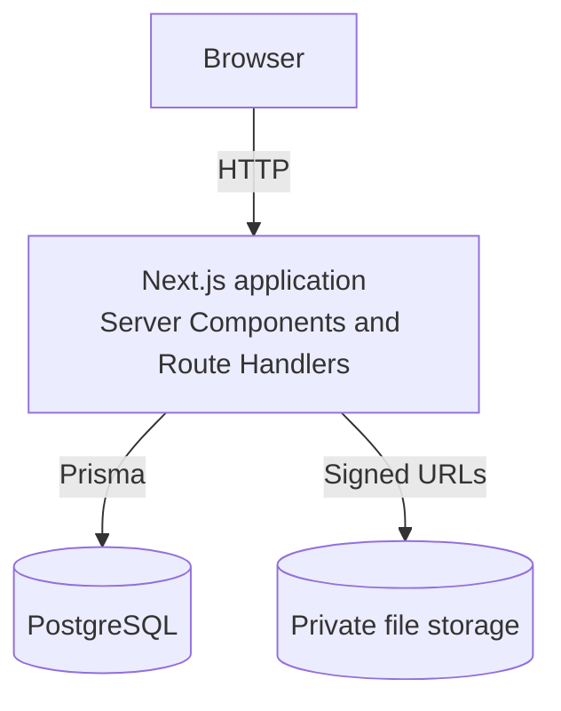
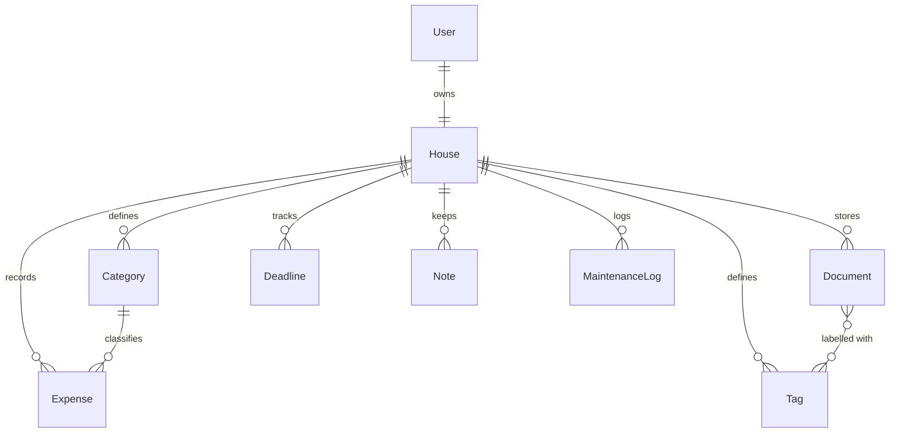

# Architecture

This document describes the target architecture. See the [roadmap](../README.md#roadmap) for what has been built so far, and the [ADRs](adr/README.md) for the reasons behind each choice.

## System overview

Home Manager is a single full-stack Next.js application. Pages and API endpoints live in the same project, so there is no separate backend service.



## Tech stack

| Layer          | Choice                                 | Decision                                |
| -------------- | -------------------------------------- | --------------------------------------- |
| Framework      | Next.js 16 (App Router), React 19      | [ADR-001](adr/001-nextjs-full-stack.md) |
| Language       | TypeScript                             | [ADR-001](adr/001-nextjs-full-stack.md) |
| Database       | PostgreSQL                             | [ADR-002](adr/002-postgresql.md)        |
| ORM            | Prisma                                 | [ADR-003](adr/003-prisma.md)            |
| Authentication | Better Auth                            | [ADR-004](adr/004-authentication.md)    |
| File storage   | To be confirmed                        | [ADR-005](adr/005-document-storage.md)  |
| Validation     | Zod, React Hook Form                   | [ADR-006](adr/006-zod-validation.md)    |
| UI             | Tailwind CSS, shadcn/ui, Recharts      |                                         |
| Testing and CI | Vitest, Playwright, GitHub Actions     | [ADR-007](adr/007-testing-and-ci.md)    |
| Hosting        | Vercel; database provider to be chosen |                                         |

## Data model

Simplified view. The Prisma schema will become the source of truth once it exists.



- **House:** version 1 has one house per user. Keeping it as a separate entity leaves room for multiple houses later without moving every other table.
- **Category:** belongs to a house, so each household can customise its own list. New houses start with default categories: rent, utilities, maintenance, groceries and other.
- **Deadline:** a due date that can recur, such as a contract renewal.
- **Note:** free-form text attached to the house.

## Security

- Every route in the protected area and every API endpoint requires an authenticated session.
- Every query is scoped to the authenticated user's house, so one user cannot read another user's data.
- All input is validated on the server with Zod.
- File uploads are checked for MIME type and maximum size.
- Documents are private and are served only through short-lived signed URLs.
- Secrets are kept in environment variables and are never committed.

## Project structure

```text
home-manager/
├── app/                  # Next.js App Router
│   ├── (auth)/           # Login and registration
│   ├── (dashboard)/      # Protected area
│   │   ├── expenses/
│   │   ├── documents/
│   │   ├── deadlines/
│   │   ├── notes/
│   │   └── maintenance/
│   └── api/              # Route Handlers
├── components/
│   ├── ui/               # shadcn/ui components
│   └── features/         # Feature-specific components
├── lib/
│   ├── prisma.ts         # Prisma client singleton
│   └── validations/      # Zod schemas
├── prisma/
│   ├── schema.prisma
│   └── migrations/
├── docs/                 # Architecture and ADRs
└── public/
```

Only the parts already built exist in the repository today. The rest are added by the feature that needs them.
